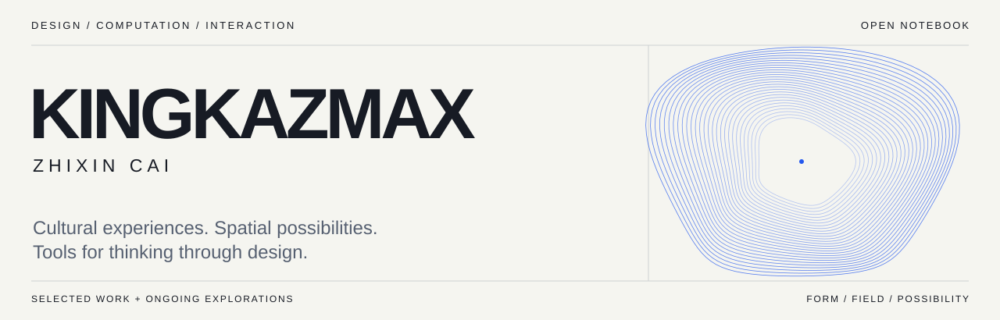

<picture>
  <source media="(prefers-color-scheme: dark)" srcset="assets/profile-dark.svg">
  
</picture>

<a href="https://kingkazmax.github.io/KINGKAZMAX/">Explore the interactive index ↗</a> · <a href="#selected-work">Selected work</a> · <a href="#中文介绍">中文</a>

## ZHIXIN CAI / KINGKAZMAX

I work in design, exploring how computation can shape cultural experiences, spatial possibilities, and creative tools.

**Current interests** — Design Research · Creative Coding · Human–AI Interaction · Computational Design · Digital Heritage

Here I share prototypes, design tools, and the processes behind them. I’m interested in conversations with design researchers, creative technologists, and open-source collaborators.

### Selected work

| Project | What to explore | Context |
|:---|:---|:---|
| **[贵傩戏 · Nuo Culture Digital Museum](https://github.com/KINGKAZMAX/nuo-culture-digital-museum)** | Point-cloud masks, gesture interaction, and browser-based AR. [Enter the museum ↗](https://kingkazmax.github.io/nuo-culture-digital-museum/) | Cultural experience · Three.js / MediaPipe |
| **[Urban Co-Creation · Procedural Massing](https://github.com/KINGKAZMAX/DigitalFUTURES2026-UrbanCoCreation-Team4-ProceduralMassing)** | Signed-distance fields, four massing families, and versioned design studies. | DigitalFUTURES 2026 · Team 4 · Rhino / Python |
| **[Immersive HCI · Evidence Governance](https://github.com/KINGKAZMAX/immersive-hci-evidence-governance)** | A review manuscript, frozen search specification, conceptual figure, and document-building code. | Manuscript & methods · Publication not claimed |
| **[AdventuregameX](https://github.com/KINGKAZMAX/AdventuregameX)** | A hub for a tactile 3D Game Boy experience and a virtual-pet toy. | Web experience prototype · Third-party components credited in the repository |
| **[Artist Archive](https://github.com/KINGKAZMAX/kingkazmax-artist-archive)** | AI-assisted character studies, documented prompts, and a browser-based remix interface. | Creative process archive · Canvas remix |
| **[DesignVault-Z](https://github.com/KINGKAZMAX/DesignVault-Z)** | A searchable, curated index of design resources. | Resource curation · Sources belong to their respective creators |

### Questions I’m exploring

- **Culture × interaction** — How can gestures and spatial interfaces invite closer encounters with cultural material?
- **Space × computation** — How can a parametric study make design alternatives easier to compare and discuss?
- **AI × creative practice** — How can AI-assisted workflows preserve the reasoning, attribution, and decisions behind a prototype?

These are directions for exploration. The repositories document prototypes and methods; they are not claims of validated research outcomes.

<b>Process, experiments & collaboration</b>

I use this space as a working archive: question → prototype → documentation → revision. Individual repositories describe their dependencies, team context, sources, and current limitations.

- **Start with a project:** open its README for context and instructions, then explore the code and design versions.
- **Discuss a concrete idea:** open an issue in the relevant repository with the question, context, and proposed contribution.
- **Other experiments:** [P2P LLM OS project archive](docs/p2p-llm-os.md) — an earlier hackathon project; its historical service-status claims have not been revalidated.
- **Related explorations:** [再观 · exhibition memory](https://github.com/KINGKAZMAX/zaiguan) and [Unbuilt City · an architectural adaptation of Overdrive City](https://github.com/KINGKAZMAX/unbuilt-city).
- **Browse the full collection:** [organized repository index](docs/REPOSITORIES.md) · [all public repositories](https://github.com/KINGKAZMAX?tab=repositories).

### 中文介绍

我是 ZHIXIN CAI，以设计学为出发点，探索计算技术如何参与文化体验、空间设计与创作工具。

这里收录我的交互原型、设计工具与过程记录：从傩文化的数字展陈，到程序化体量研究，再到观展记忆与设计资源整理。也关注 AI 辅助创作中，设计判断、过程记录与来源署名如何被保留下来。

欢迎设计研究、创意编程与开源社区的交流合作。具体项目的协作背景、依赖与素材来源，请以各仓库说明为准。

---
Selected projects, evolving questions. / 以作品为入口，以过程为依据。
