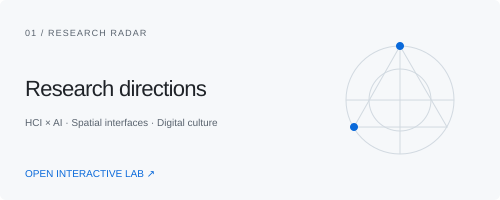
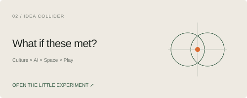
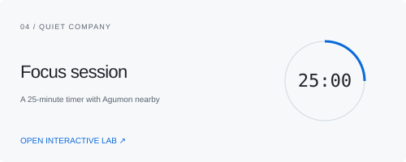

<picture>
  <source media="(prefers-color-scheme: dark)" srcset="assets/profile-dark.svg">
  
</picture>

<b>ZHIXIN CAI</b> HCI × AI &nbsp; / &nbsp; COMPUTATIONAL SPACE &nbsp; / &nbsp; DIGITAL CULTURE

I am developing research questions at the intersection of **human–AI interaction, computational and spatial design, and digital cultural heritage**. I am preparing to apply for doctoral research in these areas, with particular interest in how intelligent systems shape human judgment, how space becomes an interface, and how immersive experiences mediate cultural memory.

I have participated in **PTCG tournaments** and **hackathons**. Strategic play, rapid prototyping, and critical reflection continue to inform the questions I explore.

   
  <b>AGUMON</b> 
  Animated from an existing local sprite. Select an action to open the interactive site.  
  <a href="https://kingkazmax.github.io/KINGKAZMAX/?action=feed#home">◒ Feed</a> ·
  <a href="https://kingkazmax.github.io/KINGKAZMAX/?action=pat#home">♡ Pat</a> ·
  <a href="https://kingkazmax.github.io/KINGKAZMAX/?action=play#home">↗ Play</a> ·
  <a href="https://kingkazmax.github.io/KINGKAZMAX/?action=rest#home">☾ Rest</a>

<a href="https://kingkazmax.github.io/KINGKAZMAX/"><b>Open the interactive research site ↗</b></a>

<table>
<tr><td width="50%"><a href="https://kingkazmax.github.io/KINGKAZMAX/#research"><picture><source media="(prefers-color-scheme: dark)" srcset="assets/research-radar-dark.svg"></picture></a></td><td width="50%"><a href="https://kingkazmax.github.io/KINGKAZMAX/#collision"><picture><source media="(prefers-color-scheme: dark)" srcset="assets/idea-collider-dark.svg"></picture></a></td></tr>
<tr><td><a href="https://kingkazmax.github.io/KINGKAZMAX/#ptcg"><picture><source media="(prefers-color-scheme: dark)" srcset="assets/ptcg-table-dark.svg"></picture></a></td><td><a href="https://kingkazmax.github.io/KINGKAZMAX/#focus"><picture><source media="(prefers-color-scheme: dark)" srcset="assets/focus-time-dark.svg"></picture></a></td></tr>
</table>

<a href="https://kingkazmax.github.io/KINGKAZMAX/#hackathon">↯ Hackathon prompt</a> · <a href="https://kingkazmax.github.io/KINGKAZMAX/#drawing">∿ Drawing study</a> · <a href="https://kingkazmax.github.io/KINGKAZMAX/#pocket">↳ Local notebook</a> · <a href="https://kingkazmax.github.io/KINGKAZMAX/assets.html">⌘ Repository archive</a>

<b>Current research questions</b>

- **Human × AI:** When AI participates in making, where does human judgment remain visible? How can we document decisions, evidence, and uncertainty?
- **Space × Code:** How can spatial interfaces help people understand and participate in computational design?
- **Culture × Experience:** What remains after an immersive cultural encounter? How do different interpretations and personal memories shape its meaning?
- **Play × Learning:** How might game rules, feedback, and digital companionship inform research methods? This is an emerging intersection, not a completed research result.

<b>Emerging intersections</b>

Current questions include decision records in human–AI co-creation, long-term memory after immersive cultural experiences, participation in generative spatial design, and autonomy in digital companionship. These are directions for inquiry and experimentation.

The [public repository archive](docs/ASSETS.md) records work I create, adapt, and study. Individual entries retain authorship, sources, and reuse terms.

The animated companion appears here; the interaction controls and tools run on the GitHub Pages site. Research directions remain in development. [Credits and sources](docs/CREDITS.md).
